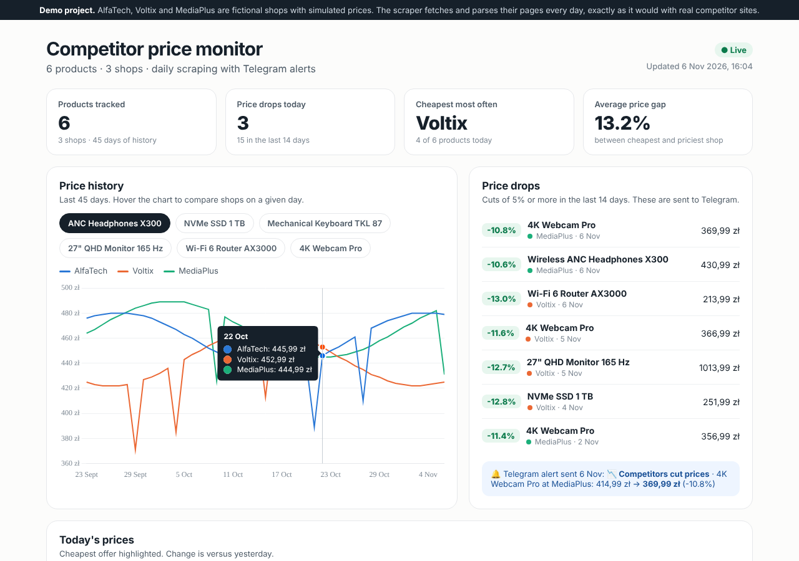

# Competitor price monitor

Every day a Python scraper collects prices from competitor shops, stores the history, shows it on a dashboard and sends a Telegram alert when someone cuts a price.



> **Demo data.** AlfaTech, Voltix and MediaPlus are fictional shops served by this project (`/api/shop`) with simulated daily prices. The scraper really downloads and parses their pages, each with different HTML, exactly like it would with real competitor sites. Pointing it at real shops means adding their selectors to `scraper/sources.json` (and checking their terms of use).

## What it does

- Scrapes several shops with different page layouts, each configured by CSS selectors in one JSON file
- Handles the usual price formats: `1 149,99 zł`, `1149.99 PLN`, split zloty/grosze markup
- Tracks stock status, keeps the full daily history in `data/prices.json`
- Detects price cuts above a threshold (5% by default) and sends them to Telegram
- Dashboard: KPIs, price history chart per product, cheapest offer per product, recent cuts
- Runs on its own every morning via GitHub Actions, no server needed, free hosting on Vercel

## Stack

Python 3 · requests · BeautifulSoup · GitHub Actions · Telegram Bot API · HTML/JS + Chart.js · Vercel

## Run locally

```bash
pip install -r scraper/requirements.txt
node dev-server.js                                          # demo shops + dashboard on :3001
SHOP_BASE=http://localhost:3001 python scraper/monitor.py   # scrape today
SHOP_BASE=http://localhost:3001 python scraper/monitor.py --backfill 45   # demo history
python -m pytest                                            # 20 tests
```

Telegram alerts are optional: set `TELEGRAM_BOT_TOKEN` and `TELEGRAM_CHAT_ID`.

## Deploy

1. Import the repository on [vercel.com](https://vercel.com): the dashboard and demo shops go live.
2. In the GitHub repo, Settings → Secrets and variables → Actions:
   - variable `SHOP_BASE` = your Vercel URL
   - secrets `TELEGRAM_BOT_TOKEN`, `TELEGRAM_CHAT_ID` (optional)
3. Actions → "Daily price check" → Run workflow. After that it runs every day, commits new prices, and Vercel redeploys the dashboard.

## Adding a shop

```json
{
  "id": "myshop",
  "name": "My Shop",
  "url": "https://example.com/category",
  "item": ".product",
  "sku": {"attr": "data-id"},
  "name_selector": ".title",
  "price_selector": ".price",
  "stock_selector": ".stock",
  "in_stock_text": "Dostępny"
}
```

## Structure

```
scraper/monitor.py     fetch → parse → store → alert
scraper/sources.json   shops and their selectors
data/prices.json       price history (updated by the daily job)
index.html             dashboard
api/shop.js            fictional demo shops
lib/catalog.js         demo products and simulated prices
.github/workflows/     daily schedule
```
